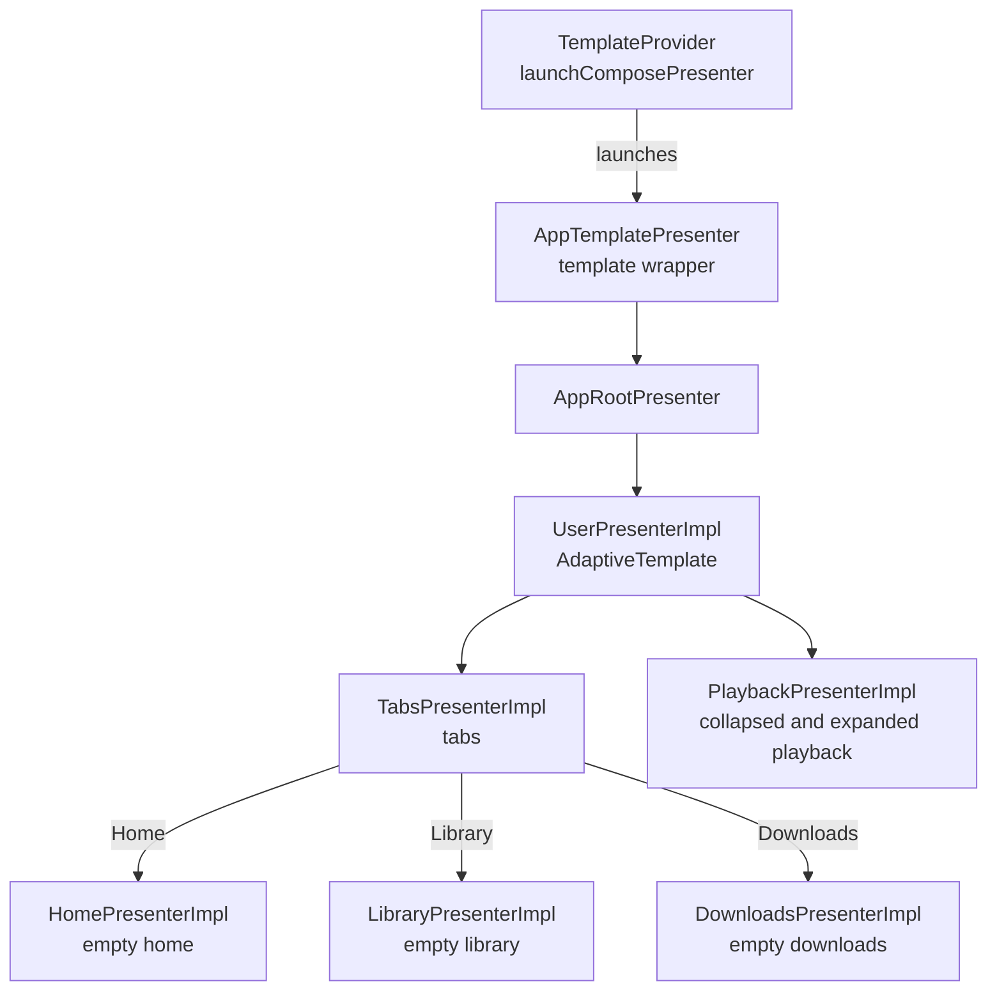

# Presenter hierarchy

Storymile uses the same presenter tree on Android, Desktop, iOS, and Wasm.
Phone and tablet layouts share this tree. Renderers place the template slots for the available window.

## Presenter tree

## Composition

[TemplateProvider](../app-framework/impl/src/commonMain/kotlin/software/ralf/storymile/TemplateProvider.kt)
starts the presenter tree.
[AppTemplatePresenter](../templates/public/src/commonMain/kotlin/software/ralf/storymile/templates/AppTemplatePresenter.kt)
wraps the app root with shared template support.

[AppRootPresenter](../app-framework/impl/src/commonMain/kotlin/software/ralf/storymile/approot/AppRootPresenter.kt)
delegates to the app-scoped
[UserPresenter](../user/public/src/commonMain/kotlin/software/ralf/storymile/user/UserPresenter.kt).
[UserPresenterImpl](../user/impl/src/commonMain/kotlin/software/ralf/storymile/user/UserPresenterImpl.kt)
obtains the
[tabs](../tabs/impl/src/commonMain/kotlin/software/ralf/storymile/tabs/TabsPresenterImpl.kt) and
[playback](../playback/impl/src/commonMain/kotlin/software/ralf/storymile/playback/PlaybackPresenterImpl.kt)
presenters from the active user scope. A scope change resets their state.
The tabs presenter owns the selected destination and produces its content model.
It starts with
[HomePresenterImpl](../home/impl/src/commonMain/kotlin/software/ralf/storymile/home/HomePresenterImpl.kt).
[HomeRenderer](../home/impl/src/commonMain/kotlin/software/ralf/storymile/home/HomeRenderer.kt)
shows the welcome screen.
The tabs presenter keeps the
[library](../library/impl/src/commonMain/kotlin/software/ralf/storymile/library/LibraryPresenterImpl.kt)
presenter in composition to retain its filter across tab changes.
[DownloadsPresenterImpl](../downloads/impl/src/commonMain/kotlin/software/ralf/storymile/downloads/DownloadsPresenterImpl.kt)
provides the empty Downloads screen, rendered by
[DownloadsRenderer](../downloads/impl/src/commonMain/kotlin/software/ralf/storymile/downloads/DownloadsRenderer.kt).
The user presenter places these models in the content, navigation, and playback slots of
[AppTemplate](../templates/public/src/commonMain/kotlin/software/ralf/storymile/templates/AppTemplate.kt).
The playback presenter supplies its slots only when the current user's
[playlists](../playlist/public/src/commonMain/kotlin/software/ralf/storymile/playlist/PlaylistRepository.kt)
contain an episode.

## Adaptive rendering

[AppTemplateRenderer](../templates/impl/src/commonMain/kotlin/software/ralf/storymile/templates/AppTemplateRenderer.kt)
places the template slots for the available window. It adapts navigation placement and playback
presentation while keeping the shared presenter tree. Use the linked source files for model details
and layout rules.

[TabsRenderer](../tabs/impl/src/commonMain/kotlin/software/ralf/storymile/tabs/TabsRenderer.kt)
shows Home, Library, and Downloads with Material icons in every navigation layout.
Side navigation also shows the Storymile logo and title.
Window resizing changes the navigation layout without changing the selected destination.

Home stacks its illustration and discovery prompt in narrow panes and places them side by side in
wide panes. The illustration shrinks to keep the content within the window.

[LibraryRenderer](../library/impl/src/commonMain/kotlin/software/ralf/storymile/library/LibraryRenderer.kt)
adapts the empty library to phone, tablet, and desktop widths.

[PlaybackScreenRenderer](../playback/impl/src/commonMain/kotlin/software/ralf/storymile/playback/PlaybackScreenRenderer.kt)
shows artwork, episode details, playback controls, and chapters. Its collapse button calls the template's
[collapse action](../templates/public/src/commonMain/kotlin/software/ralf/storymile/templates/LocalCollapsePlayback.kt).
[PlaybackBarRenderer](../playback/impl/src/commonMain/kotlin/software/ralf/storymile/playback/PlaybackBarRenderer.kt)
shows artwork and compact controls. Both layouts share fake playback state from the playback presenter.
[PlaybackTransition](../templates/public/src/commonMain/kotlin/software/ralf/storymile/templates/PlaybackTransition.kt)
moves shared artwork, text, and controls with the sheet. Controls present in only one layout fade.
The sheet slides up when playback becomes available and down when no playlist contains episodes.
