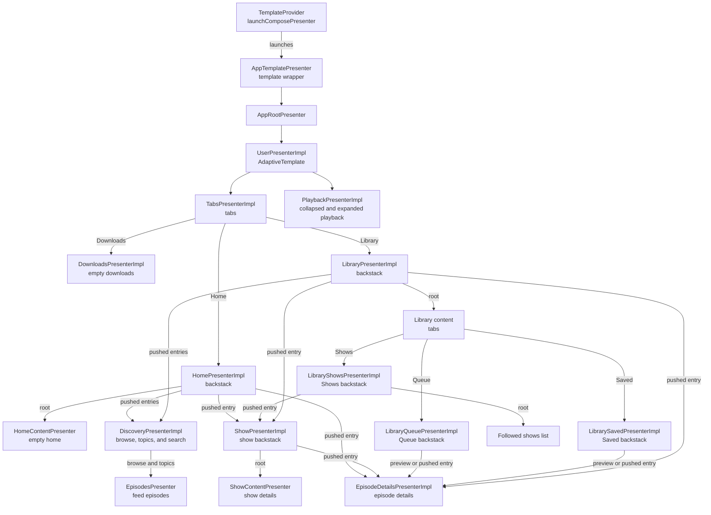
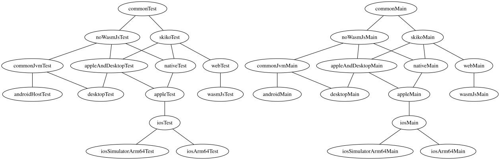

# Presenter hierarchy

Storymile uses the same presenter tree on Android, Desktop, iOS, and Wasm.
Phone and tablet layouts share this tree. Renderers place the template slots for the available window.

## Presenter tree

## Composition

[TemplateProvider](../app-framework/impl/src/commonMain/kotlin/software/ralf/storymile/TemplateProvider.kt)
starts the presenter tree.
[AppTemplatePresenter](../templates/public/src/commonMain/kotlin/software/ralf/storymile/templates/AppTemplatePresenter.kt)
wraps the app root with shared template support.

[AppRootPresenter](../app-framework/impl/src/commonMain/kotlin/software/ralf/storymile/approot/AppRootPresenter.kt)
delegates to the app-scoped
[UserPresenter](../user/public/src/commonMain/kotlin/software/ralf/storymile/user/UserPresenter.kt).
[UserPresenterImpl](../user/impl/src/commonMain/kotlin/software/ralf/storymile/user/UserPresenterImpl.kt)
obtains the
[tabs](../tabs/impl/src/commonMain/kotlin/software/ralf/storymile/tabs/TabsPresenterImpl.kt) and
[playback](../playback/impl/src/commonMain/kotlin/software/ralf/storymile/playback/PlaybackPresenterImpl.kt)
presenters from the active user scope. A scope change resets their state.
The tabs presenter owns the selected destination and produces its content model.
It starts with
[HomePresenterImpl](../home/impl/src/commonMain/kotlin/software/ralf/storymile/home/HomePresenterImpl.kt).
Home owns an App Platform presenter backstack rooted at
[HomeContentPresenter](../home/impl/src/commonMain/kotlin/software/ralf/storymile/home/HomeContentPresenter.kt).
[HomeContentRenderer](../home/impl/src/commonMain/kotlin/software/ralf/storymile/home/HomeContentRenderer.kt)
shows the welcome screen.
Discover and Search push
[DiscoveryPresenterImpl](../discovery/impl/src/commonMain/kotlin/software/ralf/storymile/discovery/presentation/DiscoveryPresenterImpl.kt).
Topic selection pushes another catalog. Podcast selection pushes
[ShowPresenterImpl](../podcast-shows/impl/src/commonMain/kotlin/software/ralf/storymile/podcastshows/ShowPresenterImpl.kt).
It owns a nested backstack rooted at
[ShowContentPresenter](../podcast-shows/impl/src/commonMain/kotlin/software/ralf/storymile/podcastshows/ShowContentPresenter.kt).
Discovery composes
[EpisodesPresenter](../discovery/impl/src/commonMain/kotlin/software/ralf/storymile/discovery/presentation/EpisodesPresenter.kt)
for recommendations. The show content presenter supplies episodes for the selected show.
Both use the shared
[episode components](../podcast-shows/public/src/commonMain/kotlin/software/ralf/storymile/podcastshows/Episodes.kt).
Episode selection pushes the reusable
[episode details presenter](../episode-details/impl/src/commonMain/kotlin/software/ralf/storymile/episodedetails/EpisodeDetailsPresenterImpl.kt)
through its [public factory](../episode-details/public/src/commonMain/kotlin/software/ralf/storymile/episodedetails/EpisodeDetailsPresenter.kt).
Its [renderer](../episode-details/impl/src/commonMain/kotlin/software/ralf/storymile/episodedetails/EpisodeDetailsRenderer.kt)
shares artwork and episode text with the source row in narrow layouts.
The [backstack renderer](../presenter-navigation/impl/src/commonMain/kotlin/software/ralf/storymile/presenternavigation/DefaultBackstackRenderer.kt)
supplies navigation entry identities for these UI transitions.
Back returns to the previous entry. Selecting Home opens the welcome screen.
[HomeRenderer](../home/impl/src/commonMain/kotlin/software/ralf/storymile/home/HomeRenderer.kt)
renders the `DefaultBackstackModel`.
The tabs presenter composes only the selected destination. Selecting
[Library](../library/impl/src/commonMain/kotlin/software/ralf/storymile/library/LibraryPresenterImpl.kt)
returns to its selected page and closes any open Discovery, show, or episode screens.
Each empty Library page opens Discovery. Back returns to the selected Library page.
[LibraryQueuePresenterImpl](../library-queue/impl/src/commonMain/kotlin/software/ralf/storymile/libraryqueue/LibraryQueuePresenterImpl.kt)
reads the saved queue and uses the shared episode details presenter.
[LibraryShowsPresenterImpl](../library-shows/impl/src/commonMain/kotlin/software/ralf/storymile/libraryshows/LibraryShowsPresenterImpl.kt)
reads followed shows through `SavedShowRepository` and pushes the shared show presenter in its own
backstack. Saved show details use stored metadata and episodes until the feed loads.
[LibrarySavedPresenterImpl](../library-saved/impl/src/commonMain/kotlin/software/ralf/storymile/librarysaved/LibrarySavedPresenterImpl.kt)
reads saved episodes and uses the shared episode details presenter.
[DownloadsPresenterImpl](../downloads/impl/src/commonMain/kotlin/software/ralf/storymile/downloads/DownloadsPresenterImpl.kt)
provides the empty Downloads screen, rendered by
[DownloadsRenderer](../downloads/impl/src/commonMain/kotlin/software/ralf/storymile/downloads/DownloadsRenderer.kt).
The user presenter places these models in the content, navigation, and playback slots of
[AppTemplate](../templates/public/src/commonMain/kotlin/software/ralf/storymile/templates/AppTemplate.kt).
The playback presenter supplies its slots when the user-scoped
[player](../player/public/src/commonMain/kotlin/software/ralf/storymile/player/Player.kt)
selects an episode from the Library Queue. Fake mode queues samples from three podcasts.

## Adaptive rendering

[AppTemplateRenderer](../templates/impl/src/commonMain/kotlin/software/ralf/storymile/templates/AppTemplateRenderer.kt)
places the template slots for the available window. It adapts navigation placement and playback
presentation while keeping the shared presenter tree. Use the linked source files for model details
and layout rules.

[KmpApplication](../app-framework/impl/src/commonMain/kotlin/software/ralf/storymile/KmpApplication.kt)
shows the [boat](../launch-animation/public/src/commonMain/kotlin/software/ralf/storymile/launchanimation/LaunchAnimation.kt)
before it creates the app scope in the background. The host composes the template behind the boat.
The reveal waits for the first content layout and draw. Host recreation resumes an interrupted reveal;
resume does not replay a completed reveal.

[TabsRenderer](../tabs/impl/src/commonMain/kotlin/software/ralf/storymile/tabs/TabsRenderer.kt)
shows Home, Library, and Downloads with Material icons in every navigation layout.
Side navigation also shows the Storymile logo and title.
Window resizing changes the navigation layout without changing the selected destination.

Home stacks its illustration and discovery prompt in narrow panes and places them side by side in
wide panes. The illustration shrinks to keep the content within the window.

[DiscoveryRenderer](../discovery/impl/src/commonMain/kotlin/software/ralf/storymile/discovery/presentation/DiscoveryRenderer.kt)
adapts browsing, topics, and search to the available width.
[ShowRenderer](../podcast-shows/impl/src/commonMain/kotlin/software/ralf/storymile/podcastshows/ShowRenderer.kt)
renders the show backstack. In wide layouts, it places the source list beside the selected show.
Episode selection slides the list out, moves the show left, and opens episode details on the right.
Back reverses the transition.
[ShowContentRenderer](../podcast-shows/impl/src/commonMain/kotlin/software/ralf/storymile/podcastshows/ShowContentRenderer.kt)
renders the podcast and its episodes. Narrow layouts show one destination at a time.
Resizing preserves the selected episode and presenter stack.

[LibraryRenderer](../library/impl/src/commonMain/kotlin/software/ralf/storymile/library/LibraryRenderer.kt)
opens the first followed show in wide layouts. Back returns to the list and show panes.
Queue and Saved show the first episode beside the list until the user selects another.
On phones, Queue, Shows, and Saved open details in a separate entry.
Switching Library tabs preserves the selection.
[LibraryShowsRenderer](../library-shows/impl/src/commonMain/kotlin/software/ralf/storymile/libraryshows/LibraryShowsRenderer.kt)
lists followed shows.

[PlaybackScreenRenderer](../playback/impl/src/commonMain/kotlin/software/ralf/storymile/playback/PlaybackScreenRenderer.kt)
shows artwork, episode details, playback controls, and upcoming episodes. Its collapse button calls
the template's [collapse action](../templates/public/src/commonMain/kotlin/software/ralf/storymile/templates/LocalCollapsePlayback.kt).
[PlaybackBarRenderer](../playback/impl/src/commonMain/kotlin/software/ralf/storymile/playback/PlaybackBarRenderer.kt)
shows artwork and compact controls. Both layouts read the same player state.
[PlaybackTransition](../templates/public/src/commonMain/kotlin/software/ralf/storymile/templates/PlaybackTransition.kt)
moves shared artwork, text, and controls with the sheet. Controls present in only one layout fade.
The sheet slides up when playback becomes available and down when it becomes unavailable.

## Source set hierarchy

Shared modules use this [source set hierarchy](../buildSrc/src/main/kotlin/software/ralf/storymile/gradle/KmpPlugin.kt)
with Wasm enabled. The diagram shows production and test sources from `:http:impl`.

